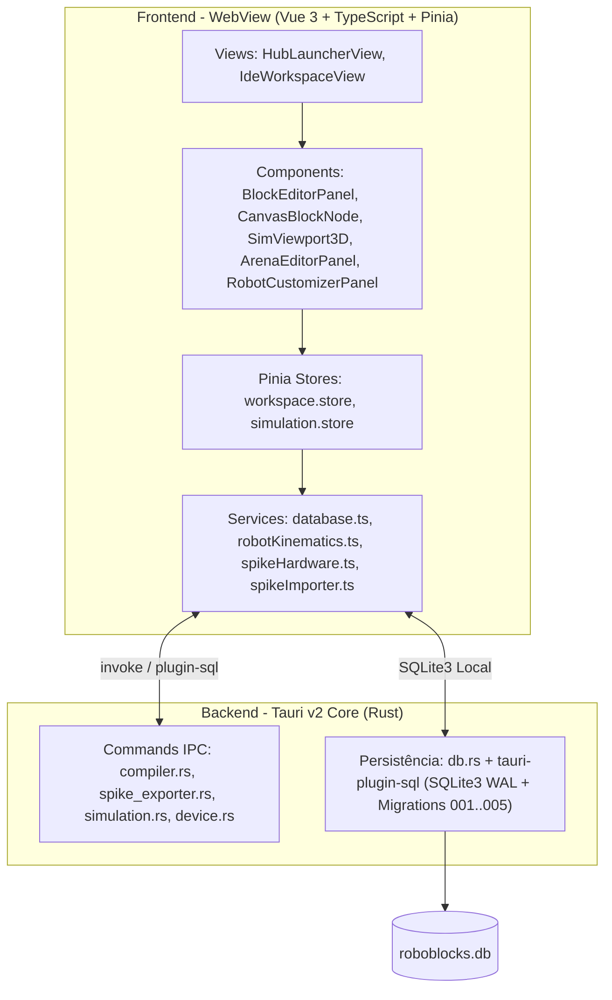

# 1. Arquitetura de Alto Nível & Estrutura de Pastas

> [📚 Índice](README.md) · [← 0. Decisões Arquiteturais (ADRs)](00-decisoes-arquiteturais.md) · [2. Diretrizes de UI/UX →](02-diretrizes-ui-ux.md)

## 1.1 Visão em Camadas (Implementação Atual)



## 1.2 Estrutura Real de Diretórios

```text
scratch_block_ide/
├── .mise.toml                               # Padronização de Node 24, Rust 1.97.1 e tasks de build/check
├── rust-toolchain.toml                      # Canal fixo do Rust (1.97.1)
├── package.json                             # Vue 3, Pinia, Three.js, @tauri-apps/plugin-sql
├── docs/
│   ├── ROADMAP.md                           # Próximos passos técnicos e funcionais
│   └── architecture/                        # Documentação arquitetural e diagramas
├── example/                                 # Projetos oficiais LEGO SPIKE (.llsp3) para testes
│
├── src-tauri/                               # ── Backend Rust / Tauri v2 ──
│   ├── Cargo.toml
│   ├── tauri.conf.json
│   ├── migrations/
│   │   ├── 001_init_hub.sql                 # Tabelas projects e canvas_states
│   │   ├── 002_init_workspace.sql           # Tabelas blocks, robot_configs, simulation_environments
│   │   ├── 003_robot_visual_and_arena.sql   # Coluna visual_json em robot_configs
│   │   ├── 004_custom_definitions.sql       # Coluna definitions_json em canvas_states
│   │   └── 005_migrate_legacy_blocks.sql    # Normalização de registros legados
│   └── src/
│       ├── lib.rs                           # Inicialização Tauri + plugin-sql + handlers IPC
│       ├── db.rs                            # Registro das migrações 1..5
│       └── commands/
│           ├── compiler.rs                  # Compilador MicroPython (SPIKE v3 e Pybricks)
│           ├── spike_exporter.rs            # Gerador .py e .llsp3 (ZIP + scratch.sb3 + roboblocks.json)
│           ├── simulation.rs                # Healthcheck e passo cinemático auxiliar
│           └── device.rs                    # Scanner USB e injeção Raw REPL / Slot
│
└── src/                                     # ── Frontend Vue 3 + TypeScript ──
    ├── App.vue                              # Alternância Hub ↔ Workspace
    ├── styles/main.css                      # Tema escuro global e contraste para <select>/<option>
    ├── types/blocks.ts                      # Tipos de blocos, formas, variáveis, listas e Meus Blocos
    ├── constants/blockCatalog.ts            # Catálogo completo das 11 seções (Motores..Meus Blocos)
    ├── stores/
    │   ├── workspace.store.ts               # Projeto ativo, kit (Prime/Essencial), blocos e definições
    │   └── simulation.store.ts              # Pose 3D, calibração cm/rot, LED RGB, Camaleão e sensores
    ├── services/
    │   ├── database.ts                      # CRUD SQLite3 (com fallback localStorage em modo browser)
    │   ├── robotKinematics.ts               # Cinemática diferencial contínua (requestAnimationFrame + atrito)
    │   ├── spikeHardware.ts                 # Bridge IPC de compilação, exportação .llsp3 e USB
    │   └── spikeImporter.ts                 # Parser/validador .llsp3, .llsp, .py e .json (round-trip 1:1)
    ├── views/
    │   ├── HubLauncherView.vue              # Hub inicial de projetos + modal de Novo Projeto
    │   └── IdeWorkspaceView.vue             # IDE completa (Blocos + Simulador 3D + Console/Python/USB)
    └── components/
        ├── BlockEditorPanel.vue             # Paleta contínua com Scroll-Spy + Canvas Drag-and-Drop
        ├── CanvasBlockNode.vue              # Renderizador recursivo (Hat, Stack, Cap, C/E-Block, Pill, Hex)
        ├── BlockCreationModals.vue          # Modais de Variáveis, Listas, Mensagens e Fazer um Bloco
        ├── PixelMatrixPicker.vue            # Seletor visual de matriz 5×5 (Luz)
        ├── SteeringDialPicker.vue           # Seletor circular -100..+100 (Movimento)
        ├── SimViewport3D.vue                # Cena 3D Three.js (OrbitControls, sombras, rodas, RGB PointLight)
        ├── ArenaEditorPanel.vue             # Editor de obstáculos, paredes, linhas e zonas (cor + atrito)
        └── RobotCustomizerPanel.vue         # Customização de kit, portas, dimensões, cor e sensores 3D
```

---

[📚 Índice](README.md) · [← 0. Decisões Arquiteturais (ADRs)](00-decisoes-arquiteturais.md) · [2. Diretrizes de UI/UX →](02-diretrizes-ui-ux.md)
