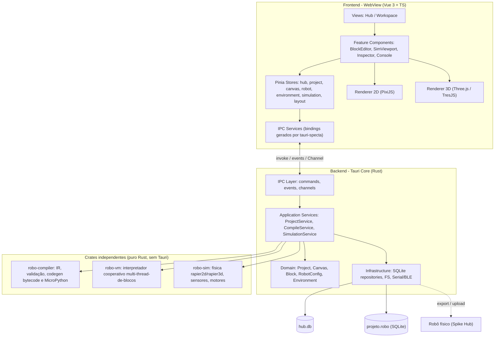

# 1. Arquitetura de Alto Nível & Estrutura de Pastas

> [📚 Índice](README.md) · [← 0. Decisões Arquiteturais (ADRs)](00-decisoes-arquiteturais.md) · [2. Diretrizes de UI/UX →](02-diretrizes-ui-ux.md)

## 1.1 Visão em Camadas



**Princípios:**
- **Os crates de domínio (`robo-compiler`, `robo-vm`, `robo-sim`) não dependem do Tauri.** Isso permite testar com `cargo test`, rodar benchmarks e, futuramente, compilar para WASM (versão web).
- **Clean Architecture no core Tauri:** `ipc` → `application` → `domain`, com a `infrastructure` injetada via traits (por exemplo `ProjectRepository`).
- **Frontend organizado por feature:** cada feature tem componentes, composables e store próprios. Os stores conversam com o backend *exclusivamente* pela camada `services/ipc`.

## 1.2 Estrutura de Diretórios

```text
roboblocks-ide/
├── Cargo.toml                      # [workspace] members = ["src-tauri", "crates/*"]
├── package.json                    # Vite + Vue + scripts (tauri dev/build, gen:bindings)
├── vite.config.ts
├── tsconfig.json
├── docs/                           # ADRs, diagramas, guia de contribuição
│
├── crates/                         # ── Núcleo puro Rust (testável isoladamente) ──
│   ├── robo-compiler/
│   │   └── src/
│   │       ├── lib.rs
│   │       ├── ir/                 # AST/IR: Program, Script, Stmt, Expr
│   │       ├── frontend/           # BlockGraph (JSON do canvas) → IR
│   │       ├── validate/           # tipos, slots vazios, variáveis indefinidas, loops
│   │       ├── codegen/
│   │       │   ├── bytecode.rs     # IR → Bytecode (VM do simulador)
│   │       │   └── micropython.rs  # IR → MicroPython (Spike / Pybricks)
│   │       └── diagnostics.rs      # Diagnostic { block_id, severity, message }
│   ├── robo-vm/
│   │   └── src/                    # Interpreter, Thread (green threads), Scheduler, HAL trait
│   └── robo-sim/
│       └── src/
│           ├── world.rs            # World, fixed-step loop
│           ├── physics/            # backend rapier2d | rapier3d (feature flags)
│           ├── robot/              # DifferentialDrive, Motor (PID), Encoder
│           ├── sensors/            # Color, Distance (raycast), Force, Gyro/IMU
│           └── hal_sim.rs          # impl robo_vm::Hal para o robô virtual
│
├── src-tauri/                      # ── Aplicação Tauri v2 ──
│   ├── Cargo.toml
│   ├── tauri.conf.json
│   ├── build.rs
│   ├── capabilities/
│   │   ├── hub.json                # permissões da janela/rota do Hub
│   │   └── workspace.json          # permissões do Workspace (dialog, fs escopado, serial)
│   ├── migrations/
│   │   ├── hub/0001_init.sql
│   │   └── project/0001_init.sql
│   ├── icons/
│   └── src/
│       ├── main.rs                 # chama lib::run()
│       ├── lib.rs                  # Builder: plugins, state, invoke_handler, specta export
│       ├── error.rs                # AppError (thiserror + Serialize) → erro tipado no TS
│       ├── state.rs                # AppState { hub_db, open_projects, sim_sessions }
│       ├── ipc/
│       │   ├── mod.rs              # registro de commands (collect_commands!)
│       │   ├── dto.rs              # DTOs serializáveis (specta::Type)
│       │   ├── events.rs           # nomes e payloads de eventos
│       │   └── commands/
│       │       ├── hub.rs          # list_recent, create_project, open_project, templates
│       │       ├── project.rs      # save, rename, export, snapshots
│       │       ├── canvas.rs       # apply_canvas_ops, load_canvas
│       │       ├── robot.rs        # get/update robot config, ports
│       │       ├── environment.rs  # CRUD de arena/objetos
│       │       ├── compiler.rs     # compile, generate_python
│       │       ├── simulation.rs   # sim_start/pause/step/reset/stop, subscribe
│       │       └── device.rs       # listar portas seriais/BLE, upload para o robô
│       ├── application/            # casos de uso (orquestração, transações)
│       │   ├── project_service.rs
│       │   ├── compile_service.rs
│       │   └── simulation_service.rs   # dono da thread de simulação
│       ├── domain/                 # entidades + traits de repositório
│       └── infrastructure/
│           ├── db/
│           │   ├── pool.rs         # SqlitePool por projeto aberto (WAL mode)
│           │   └── repositories/   # SqliteProjectRepo, SqliteCanvasRepo, ...
│           ├── fs/                 # caminhos, thumbnails, import/export .robo
│           └── device/             # serial (serialport) / BLE (btleplug)
│
└── src/                            # ── Frontend Vue 3 ──
    ├── main.ts
    ├── App.vue
    ├── router/                     # /hub, /workspace/:projectId
    ├── bindings/                   # ⚠ GERADO pelo tauri-specta (não editar)
    │   └── commands.ts
    ├── services/ipc/               # wrappers finos sobre os bindings (Result → exceção/toast)
    │   ├── projectApi.ts
    │   ├── canvasApi.ts
    │   ├── simulationApi.ts
    │   └── ...
    ├── stores/                     # Pinia (setup stores)
    │   ├── hub.store.ts
    │   ├── project.store.ts        # metadata + estado de sujeira/autosave
    │   ├── canvas.store.ts         # grafo de blocos, undo/redo, seleção
    │   ├── robot.store.ts
    │   ├── environment.store.ts
    │   ├── simulation.store.ts     # máquina de estados da execução + telemetria
    │   ├── layout.store.ts         # docks, split, abas (persistido)
    │   └── settings.store.ts       # tema, idioma, acessibilidade
    ├── features/
    │   ├── hub/                    # HubView, ProjectCard, TemplateGallery, NewProjectDialog
    │   ├── workspace/              # WorkspaceView, DockLayout, Toolbar, StatusBar
    │   ├── blocks/
    │   │   ├── BlockEditor.vue     # wrapper do Blockly
    │   │   ├── adapter/            # BlockEditorAdapter (interface) + BlocklyAdapter
    │   │   ├── definitions/        # motion.ts, sensors.ts, control.ts, operators.ts, variables.ts
    │   │   ├── toolbox/            # categorias, cores, ícones
    │   │   └── theme/              # tema Spike-like (claro/escuro, alto contraste)
    │   ├── simulation/
    │   │   ├── SimViewport.vue     # escolhe o renderer 2D ou 3D
    │   │   ├── renderers/          # Pixi2DRenderer.ts, Three3DRenderer.ts (interface Renderer)
    │   │   ├── interpolation.ts    # interpola entre frames da física
    │   │   ├── RunControls.vue     # Play / Pause / Step / Reset
    │   │   ├── SensorDebugPanel.vue
    │   │   └── ArenaEditor/        # gizmos, paleta de objetos, snapping
    │   ├── robot/                  # RobotConfigurator (portas A–F, dimensões)
    │   ├── console/                # saída de print, diagnósticos clicáveis (→ bloco)
    │   └── code-preview/           # visualização somente leitura do MicroPython gerado
    ├── shared/
    │   ├── ui/                     # design system: Button, Panel, Tabs, Splitter, Tooltip
    │   ├── composables/            # useHotkeys, useDebounce, useResizeObserver, useTauriEvent
    │   ├── types/                  # tipos de UI (os de domínio vêm de bindings/)
    │   └── utils/
    ├── assets/                     # ícones, modelos 3D (glTF), texturas de tapetes
    └── styles/                     # tokens.css (cores por categoria, espaçamentos)
```

---

[📚 Índice](README.md) · [← 0. Decisões Arquiteturais (ADRs)](00-decisoes-arquiteturais.md) · [2. Diretrizes de UI/UX →](02-diretrizes-ui-ux.md)
