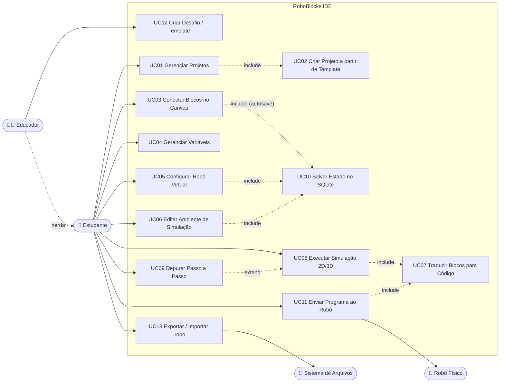

# 3. Casos de Uso

> [📚 Índice](README.md) · [← 2. Diretrizes de UI/UX](02-diretrizes-ui-ux.md) · [4. Modelagem de Dados & Diagrama de Classes →](04-modelagem-de-dados.md)

## 3.1 Atores

| Ator | Tipo | Descrição |
|------|------|-----------|
| **Estudante** | Primário | Cria projetos, programa com blocos, configura arena e robô, simula. |
| **Educador** | Primário (especialização do Estudante) | Cria templates e desafios, distribui e corrige projetos `.robo`. |
| **Robô Físico (Spike Hub)** | Secundário (sistema externo) | Recebe o programa MicroPython via USB/BLE. |
| **Sistema de Arquivos / SO** | Secundário | Diálogos de abrir/salvar, armazenamento dos `.robo`. |

## 3.2 Diagrama de Casos de Uso

## 3.3 Detalhamento dos Casos de Uso Centrais

### UC01 — Gerenciar Projetos
| Campo | Descrição |
|-------|-----------|
| **Ator** | Estudante |
| **Pré-condição** | Aplicação iniciada; `hub.db` migrado. |
| **Fluxo principal** | 1. O sistema exibe o Hub com os projetos recentes (`hub.list_recent`). 2. O estudante escolhe **Novo**, informa nome, template, robô e tipo de arena (2D/3D). 3. O sistema cria `<pasta>/<nome>.robo`, aplica as migrações, insere os dados do template e registra o projeto no `hub.db`. 4. O sistema abre o Workspace. |
| **Fluxos alternativos** | **A1 Abrir:** seleciona um card → `open_project(path)` → valida `schema_version` (migra se for antigo). **A2 Renomear/Duplicar/Remover da lista** (remover da lista não apaga o arquivo, a menos que confirmado). **A3 Arquivo ausente:** o card fica marcado como "não encontrado", com as opções Localizar / Remover. |
| **Exceções** | E1: arquivo corrompido → oferece restaurar o último snapshot. E2: versão do schema mais nova que o app → abre só em modo leitura. |
| **Pós-condição** | Projeto aberto e `last_opened_at` atualizado. |

### UC03 — Conectar Blocos no Canvas
| Campo | Descrição |
|-------|-----------|
| **Ator** | Estudante |
| **Pré-condição** | Projeto aberto na aba Script. |
| **Fluxo principal** | 1. O estudante escolhe uma categoria na paleta. 2. Arrasta um bloco para o canvas. 3. Aproxima o bloco de um conector compatível. O sistema mostra a pré-visualização do encaixe (*snap*) apenas se o tipo for compatível (ex.: `Boolean` só entra em slot hexagonal). 4. Solta o bloco: o sistema atualiza o grafo (`parent`/`next`/`input`) e registra a operação no histórico de undo. 5. O `canvas.store` marca o projeto como *dirty* e agenda o autosave (UC10). 6. A validação incremental roda em background e mostra avisos nos blocos (ex.: slot vazio). |
| **Alternativos** | A1: soltar fora do canvas ou sobre a paleta → o bloco é excluído. A2: arrastar a pilha inteira, ou seja, o bloco e todos os que estão abaixo dele. A3: duplicar com Ctrl+D ou pelo menu de contexto. A4: comentário anexado ao bloco. |
| **Regras de negócio** | RN01: um bloco *Hat* (evento) só pode ser raiz. RN02: um bloco *Cap* (ex.: "parar tudo") não aceita `next`. RN03: tipos dos inputs: `Number`, `String`, `Boolean`, `Port`, `Color`. |
| **Pós-condição** | Grafo de blocos consistente e operação no histórico. |

### UC07 — Traduzir Blocos para Código
| Campo | Descrição |
|-------|-----------|
| **Ator** | Sistema (disparado pelo UC08 ou UC11) ou Estudante (aba "Código Python") |
| **Fluxo principal** | 1. O frontend envia o `BlockGraph` serializado, ou só o `canvas_id`, já que o backend lê a versão persistida. 2. `robo-compiler` converte grafo → IR (uma `Script` por bloco Hat). 3. A validação checa tipos, variáveis, portas inexistentes no `RobotConfig` e recursão infinita sem espera. 4. A geração produz `Bytecode` (com `block_id` em cada instrução) e/ou `MicroPython`. 5. O resultado volta como `CompileResult { diagnostics, program_id, python_source? }`. |
| **Exceções** | Em caso de erro, os diagnósticos são associados a `block_id`; a UI destaca os blocos e a máquina de estados volta para `Idle` com erro. |
| **Pós-condição** | Programa cacheado por um hash do grafo, o que evita recompilar sem necessidade. |

### UC08 — Executar Simulação 2D/3D
| Campo | Descrição |
|-------|-----------|
| **Ator** | Estudante |
| **Pré-condição** | Projeto com `RobotConfig` e `SimulationEnvironment` ativos. |
| **Fluxo principal** | 1. O estudante clica em ▶ Play. 2. O sistema executa o UC07 e, se não houver erros, cria a `SimulationSession` no Rust. 3. O frontend abre um `Channel<SimFrame>` e o backend inicia o loop de passo fixo (física a 120 Hz, envio de frames a 60 Hz). 4. A VM executa os scripts de forma cooperativa e lê/escreve no robô virtual pela `Hal`. 5. Cada frame leva as poses, as leituras dos sensores, os blocos ativos e os logs. 6. O frontend interpola e renderiza; o painel de sensores e o destaque dos blocos se atualizam. 7. O programa termina, ou o estudante para. |
| **Alternativos** | A1 ⏸ Pause: congela o loop, mas mantém o estado. A2 ⏭ Step: avança 1 instrução da VM (ou 1 tick da física, se configurado). A3 ⟲ Reset: devolve o robô à pose inicial e reinicia a VM. A4 controle de velocidade (0.25× a 4×). A5 o estudante arrasta o robô com o simulador pausado (*teleport*). |
| **Exceções** | E1: erro em tempo de execução (ex.: divisão por zero) → estado `RuntimeError` com o bloco destacado. E2: watchdog → loop sem `wait` por mais de N ms gera um aviso amigável. |
| **Pós-condição** | O resultado da execução pode ser registrado em `simulation_runs`, para avaliação de desafios. |

### UC10 — Salvar Estado no SQLite
| Campo | Descrição |
|-------|-----------|
| **Ator** | Sistema (autosave) ou Estudante (Ctrl+S) |
| **Fluxo principal** | 1. As alterações geram **operações** (`CanvasOp`: Create, Move, Connect, Disconnect, SetField, Delete). 2. O store acumula as operações e, após um *debounce* de cerca de 1,5 s (ou com Ctrl+S, ou ao trocar de aba), chama `apply_canvas_ops(project_id, base_revision, ops[])`. 3. O Rust aplica tudo em **uma transação**, incrementa `revision` e devolve a nova revisão. 4. O status muda para "Salvo ✓". |
| **Alternativos** | A1: a cada 10 minutos ou num marco importante (antes de rodar o simulador), gera um `project_snapshot` completo para recuperação. A2: ao fechar com alterações pendentes → *flush* síncrono antes de fechar a janela (`on_window_event: CloseRequested`). |
| **Exceções** | `revision` conflitante (por exemplo, duas janelas abertas) → recarrega e avisa. Erro de I/O → mantém a fila em memória, mostra o badge "Não salvo" e tenta de novo com *backoff*. |

### UC11 — Enviar Programa ao Robô *(resumo)*
Compila (UC07, alvo MicroPython) → lista os dispositivos (`device.list`) → envia via serial (REPL raw) ou BLE → mostra progresso e log no console.

---

[📚 Índice](README.md) · [← 2. Diretrizes de UI/UX](02-diretrizes-ui-ux.md) · [4. Modelagem de Dados & Diagrama de Classes →](04-modelagem-de-dados.md)
