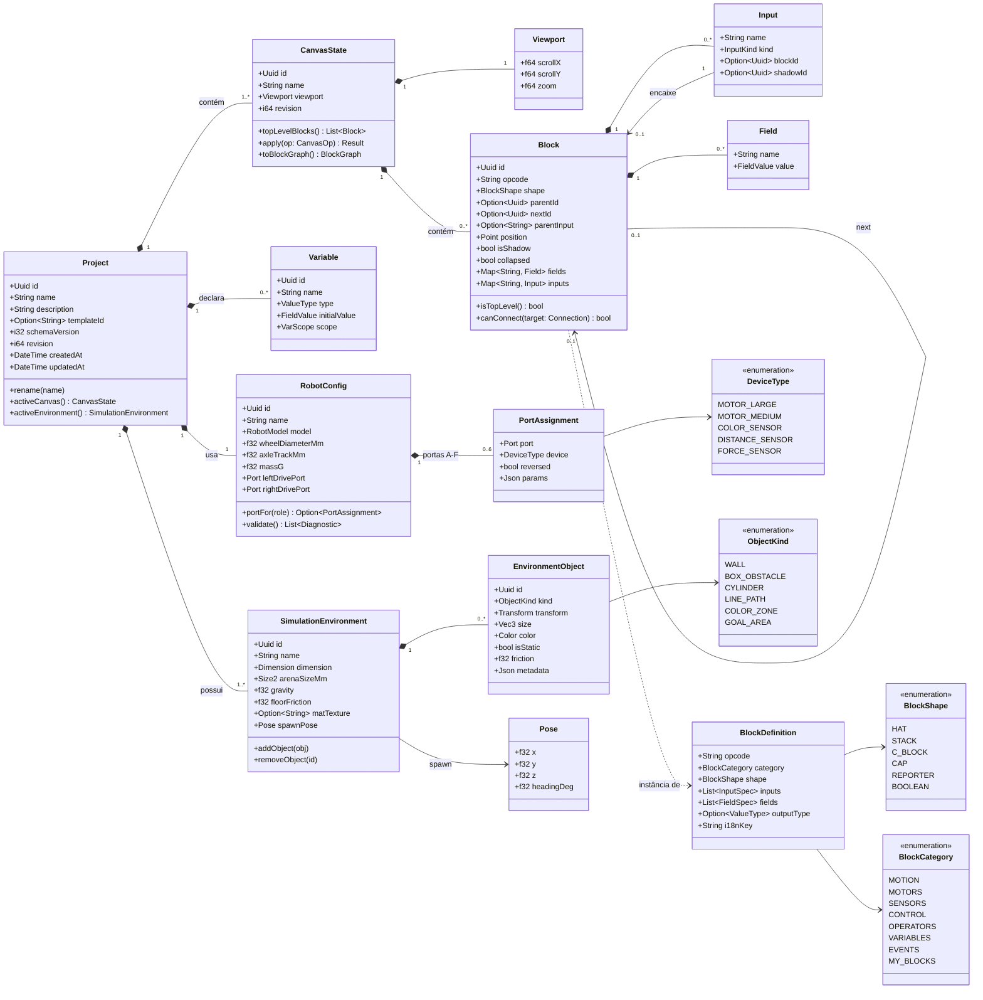
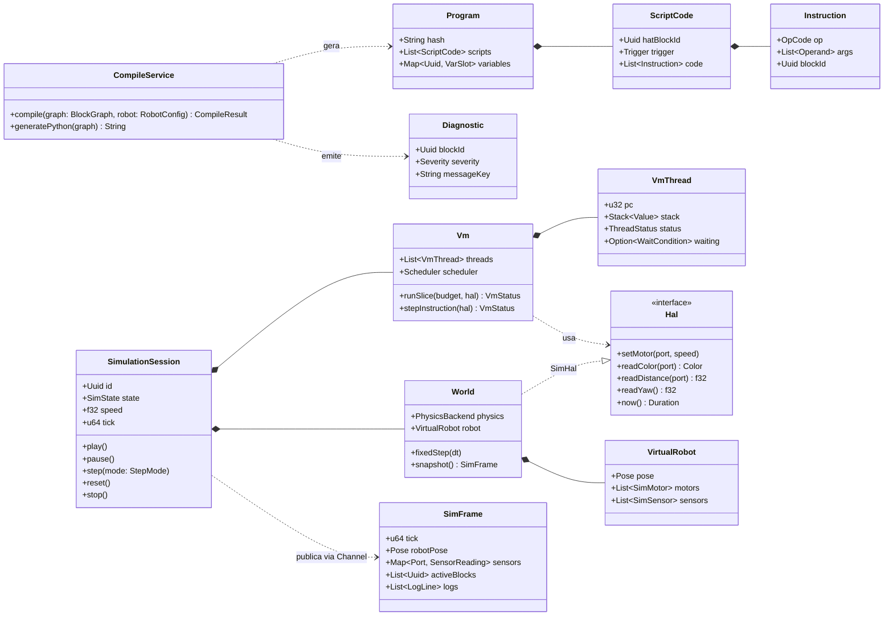
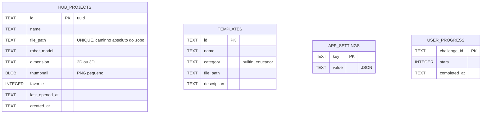
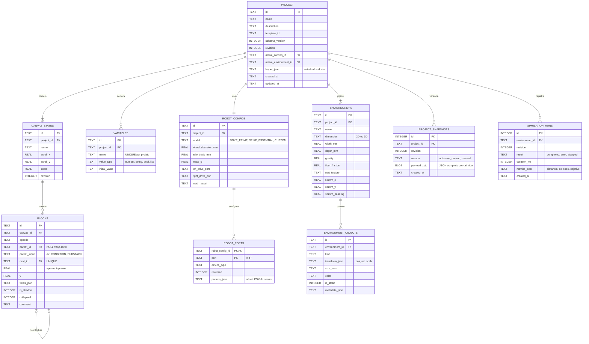

# 4. Modelagem de Dados & Diagrama de Classes

> [📚 Índice](README.md) · [← 3. Casos de Uso](03-casos-de-uso.md) · [5. Diagramas de Estados →](05-diagramas-de-estados.md)

## 4.1 Modelo de Domínio (Diagrama de Classes)



> [!NOTE]
> **Representação hierárquica dos blocos (modelo Scratch/Spike):** a árvore usa duas relações.
> - **`next`** forma a *pilha* vertical (sequência de comandos).
> - **`parent` + `parentInput`** encaixam um bloco num *slot*: um reporter dentro de um input numérico, ou o corpo de um C-block (input `SUBSTACK`).
>
> Um bloco é **top-level** quando `parentId == null`. Um script é um bloco top-level do tipo `HAT` mais toda a cadeia `next` dele.

## 4.2 Modelo de Execução (Compilador / VM / Simulação)



## 4.3 Modelo Relacional (SQLite)

**`hub.db`** (global, em `app_data_dir`):



**`<projeto>.robo`** (um SQLite por projeto):



**Notas de implementação SQL:**
```sql
PRAGMA journal_mode = WAL;        -- leituras concorrentes + escrita sem bloquear a UI
PRAGMA foreign_keys = ON;
CREATE UNIQUE INDEX ux_blocks_next   ON blocks(next_id) WHERE next_id IS NOT NULL;
CREATE UNIQUE INDEX ux_blocks_slot   ON blocks(parent_id, parent_input) WHERE parent_id IS NOT NULL;
CREATE INDEX ix_blocks_canvas_top    ON blocks(canvas_id) WHERE parent_id IS NULL;
```
- Os dois índices únicos **garantem a integridade estrutural** do grafo: um bloco tem no máximo um sucessor, e cada slot recebe só um bloco.
- **A detecção de ciclos** (um bloco encaixado em si mesmo) fica no domínio (`CanvasState::apply`) antes de persistir.
- `fields_json` guarda valores literais (ex.: `{"DIRECTION":"forward","UNIT":"cm"}`), e cada bloco com valor em input ganha um bloco *shadow* (igual ao Scratch).

---

[📚 Índice](README.md) · [← 3. Casos de Uso](03-casos-de-uso.md) · [5. Diagramas de Estados →](05-diagramas-de-estados.md)
