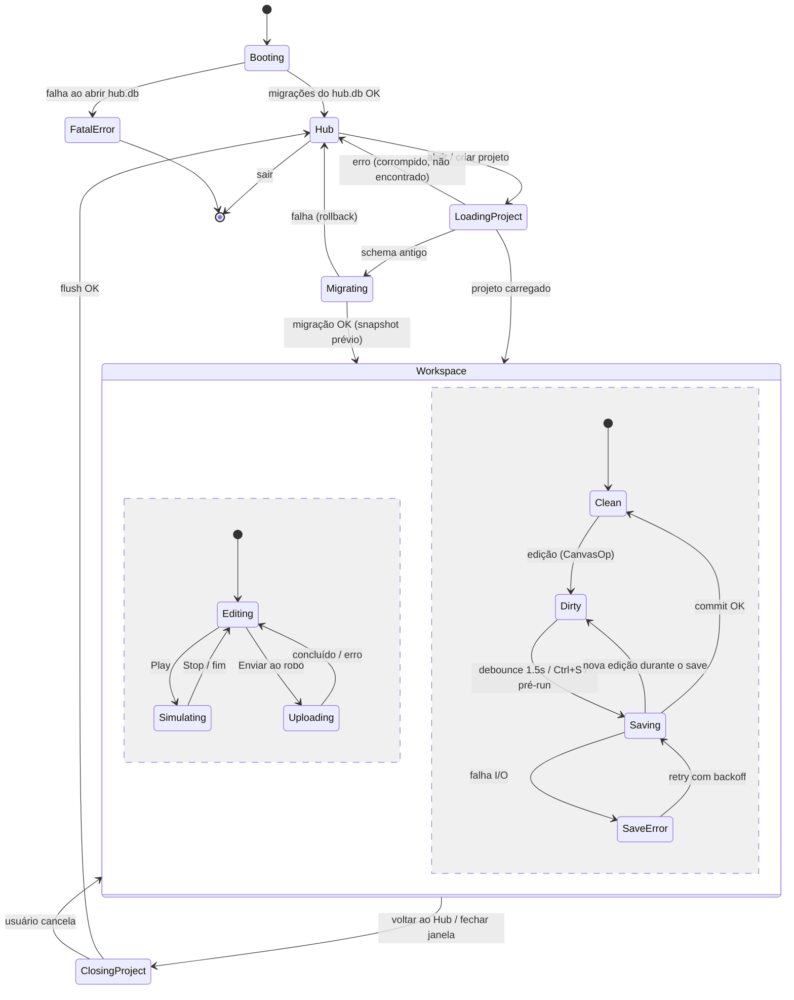
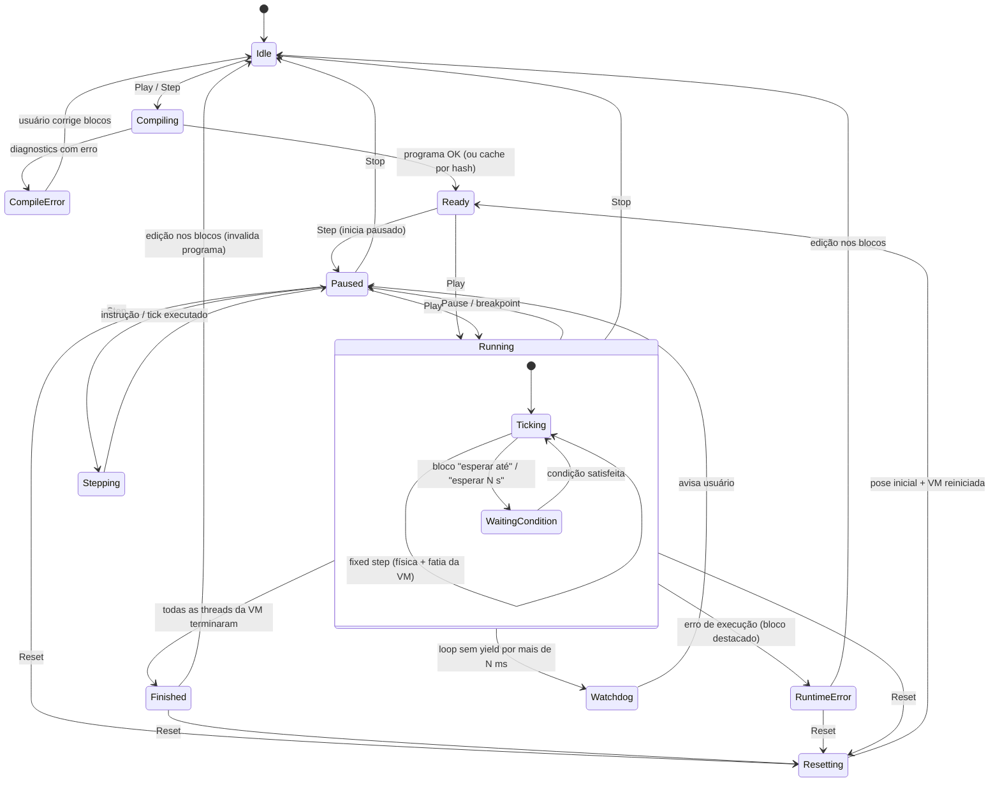

# 5. Diagramas de Estados

> [📚 Índice](README.md) · [← 4. Modelagem de Dados & Diagrama de Classes](04-modelagem-de-dados.md) · [6. Comunicação IPC (Tauri v2) →](06-comunicacao-ipc.md)

## 5.1 Ciclo de Vida da Aplicação

> [!NOTE]
> As duas regiões paralelas do `Workspace` (separadas por `--`) mostram que **o modo de interação** (Editing / Simulating / Uploading) e **o estado de persistência** (Clean / Dirty / Saving) são ortogonais. O autosave continua funcionando durante a simulação. Durante `Simulating`, o canvas fica **somente leitura** por padrão; uma configuração permite editar e aplicar a mudança no próximo Reset.

## 5.2 Execução da Simulação / Robô

**Tabela de transições (contrato entre a UI e o backend):**

| Estado | ▶ Play | ⏸ Pause | ⏭ Step | ⟲ Reset | ⏹ Stop | Edição no canvas |
|--------|:------:|:-------:|:------:|:-------:|:------:|:----------------:|
| Idle | compila → Running | — | compila → Paused | — | — | permitido |
| Ready | Running | — | Paused | — | Idle | invalida → Idle |
| Running | — | Paused | — | Resetting | Idle | bloqueado* |
| Paused | Running | — | Stepping | Resetting | Idle | bloqueado* |
| Finished / RuntimeError | Resetting → Running | — | — | Resetting | Idle | invalida → Idle |

> [!IMPORTANT]
> **O Rust é a fonte de verdade da máquina de estados.** O `simulation.store` (Pinia) é apenas um *espelho*: ele envia **intenções** (`sim_play`), e o estado só muda quando chega o evento `sim://state-changed`. Assim, a UI nunca fica dessincronizada da thread de simulação. Os botões são habilitados a partir da tabela acima.

---

[📚 Índice](README.md) · [← 4. Modelagem de Dados & Diagrama de Classes](04-modelagem-de-dados.md) · [6. Comunicação IPC (Tauri v2) →](06-comunicacao-ipc.md)
