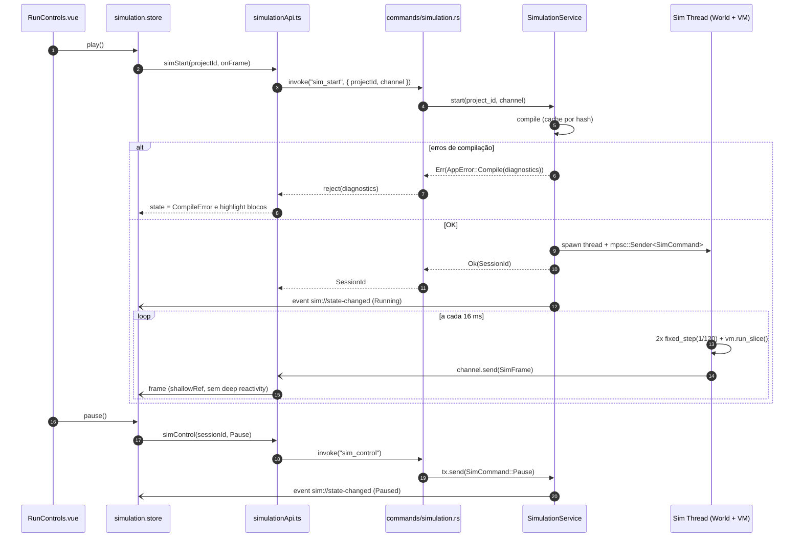

# 6. Comunicação IPC (Tauri v2)

> [📚 Índice](README.md) · [← 5. Diagramas de Estados](05-diagramas-de-estados.md) · [7. Próximos Passos →](07-proximos-passos.md)

## 6.1 Três Mecanismos, Três Propósitos

| Mecanismo | Direção | Uso | Exemplos |
|-----------|---------|-----|----------|
| **Commands** (`invoke`) | FE → BE (request/response, `async`) | CRUD, ações pontuais, compilação | `create_project`, `apply_canvas_ops`, `compile`, `sim_play` |
| **Events** (`emit` / `listen`) | BE → FE (broadcast, baixa frequência) | Mudanças de estado e notificações | `sim://state-changed`, `project://saved`, `device://connected` |
| **Channels** (`tauri::ipc::Channel<T>`) | BE → FE (stream ordenado, alta frequência) | Telemetria da simulação a 60 Hz e progresso de upload | `SimFrame`, `UploadProgress` |

## 6.2 Fluxo: Play na Simulação



## 6.3 Padrões de Implementação

**Rust — command de controle e streaming via Channel:**
```rust
// src-tauri/src/ipc/commands/simulation.rs
#[tauri::command]
#[specta::specta]
pub async fn sim_start(
    project_id: Uuid,
    on_frame: Channel<SimFrame>,            // stream de alta frequência
    app: AppHandle,
    state: State<'_, AppState>,
) -> Result<SessionId, AppError> {
    state.simulation.start(&app, project_id, on_frame).await
}

#[tauri::command]
#[specta::specta]
pub fn sim_control(
    session_id: SessionId,
    cmd: SimCommand,                          // Play | Pause | Step(StepMode) | Reset | Stop | SetSpeed(f32)
    state: State<'_, AppState>,
) -> Result<(), AppError> {
    state.simulation.send(session_id, cmd)    // mpsc → thread de simulação (não bloqueia)
}
```

**Rust — persistência por operações (transação atômica):**
```rust
#[tauri::command]
#[specta::specta]
pub async fn apply_canvas_ops(
    project_id: Uuid,
    base_revision: i64,
    ops: Vec<CanvasOp>,                       // Create | Move | Connect | Disconnect | SetField | Delete
    state: State<'_, AppState>,
) -> Result<i64, AppError> {                  // devolve a nova revisão
    state.projects.apply_canvas_ops(project_id, base_revision, ops).await
}
```

**Erros tipados** (serializados como união discriminada no TS):
```rust
#[derive(Debug, thiserror::Error, Serialize, specta::Type)]
#[serde(tag = "kind", content = "data")]
pub enum AppError {
    #[error("projeto não encontrado")]      NotFound { path: String },
    #[error("conflito de revisão")]         RevisionConflict { current: i64 },
    #[error("erros de compilação")]         Compile(Vec<Diagnostic>),
    #[error("banco de dados: {0}")]         Database(String),
    #[error("dispositivo: {0}")]            Device(String),
}
```

**TypeScript — store consumindo o stream sem sobrecarregar a reatividade:**
```ts
// src/stores/simulation.store.ts
export const useSimulationStore = defineStore('simulation', () => {
  const state = ref<SimState>('Idle')
  const frame = shallowRef<SimFrame | null>(null)   // shallowRef: substitui o objeto inteiro, sem proxies profundos
  const sessionId = ref<SessionId | null>(null)

  useTauriEvent<SimStateChanged>('sim://state-changed', (e) => { state.value = e.state })

  async function play() {
    if (sessionId.value) return simulationApi.control(sessionId.value, { type: 'Play' })
    const channel = new Channel<SimFrame>()
    channel.onmessage = (f) => { frame.value = f }  // renderer lê frame no requestAnimationFrame
    sessionId.value = await simulationApi.start(useProjectStore().id!, channel)
  }
  // pause, step, reset, stop → simulationApi.control(...)
  return { state, frame, play /* ... */ }
})
```

## 6.4 Regras e Boas Práticas

1. **Contrato único gerado:** `tauri-specta` exporta `src/bindings/commands.ts` em `cargo build` (debug). O frontend **nunca** chama `invoke("string")` diretamente, só pelos bindings, o que dá autocomplete e erro de compilação se o contrato mudar.
2. **Nada bloqueante no thread principal:** commands de I/O são `async` (sqlx). A simulação roda numa **thread dedicada** (`std::thread`), com comunicação por `crossbeam_channel`/`mpsc`, e nunca dentro de um command.
3. **Estado compartilhado:** `AppState` registrado com `app.manage(...)`; `RwLock`/`Mutex` de granularidade fina (um pool por projeto aberto, uma sessão por janela).
4. **Persistência por operações, não por dumps:** o frontend envia `CanvasOp[]` com `base_revision` (controle otimista de concorrência). Os snapshots completos são exceção (pré-run, a cada 10 min, ou manual).
5. **Telemetria enxuta:**
   - Envio a 60 Hz, com a física a 120 Hz rodando internamente; o frontend **interpola** as poses.
   - Envie só deltas ou campos que mudaram. Para cenas grandes (3D, muitos objetos dinâmicos), use payload binário (`InvokeResponseBody::Raw` / `bincode`) em vez de JSON.
   - No Vue, use `shallowRef` e `markRaw` para objetos do Three.js e do Pixi: nunca deixe a engine de render ficar reativa.
6. **Segurança (capabilities do Tauri v2):**
   - `capabilities/hub.json` e `workspace.json` liberam apenas os commands e plugins necessários (`dialog:allow-open`, `dialog:allow-save`, `fs` restrito a `$APPDATA` e às pastas escolhidas pelo usuário).
   - A CSP fica restrita, sem `remote` URLs, e o plugin SQL **não** é exposto ao frontend.
7. **Plugins Tauri recomendados:** `tauri-plugin-dialog`, `tauri-plugin-fs` (escopado), `tauri-plugin-store` (preferências leves de UI, se preferir em vez do `app_settings`), `tauri-plugin-window-state` (posição/tamanho da janela), `tauri-plugin-updater`, `tauri-plugin-log`.
8. **Ciclo de vida:** `on_window_event(CloseRequested)` faz `prevent_close` → emite `app://flush-request` → o store envia as operações pendentes → o backend encerra as sessões de simulação → fecha a janela.

---

[📚 Índice](README.md) · [← 5. Diagramas de Estados](05-diagramas-de-estados.md) · [7. Próximos Passos →](07-proximos-passos.md)
