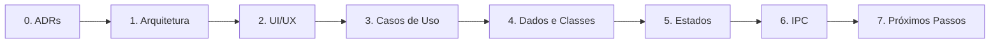

# RoboBlocks IDE — Documentação de Arquitetura

> **Stack:** Tauri v2 (Rust) · Vue 3 + TypeScript + Pinia · SQLite3 · Simulador 2D/3D integrado
> **Público:** estudantes de robótica educacional (programação em blocos estilo LEGO Spike) · **UX de referência:** Godot Engine

## 📚 Índice

| # | Documento | Conteúdo |
|---|-----------|----------|
| 0 | [Decisões Arquiteturais (ADRs)](00-decisoes-arquiteturais.md) | Decisões-chave e justificativas (simulação em Rust, IR única, `.robo` por projeto, IPC tipado) |
| 1 | [Arquitetura & Estrutura de Pastas](01-arquitetura-e-estrutura-de-pastas.md) | Visão em camadas, crates Rust, organização do frontend Vue |
| 2 | [Diretrizes de UI/UX](02-diretrizes-ui-ux.md) | Wireframes do Hub e do Workspace, atalhos, acessibilidade |
| 3 | [Casos de Uso](03-casos-de-uso.md) | Atores, diagrama e detalhamento dos casos de uso centrais |
| 4 | [Modelagem de Dados & Classes](04-modelagem-de-dados.md) | Diagrama de classes (domínio e execução) e modelo relacional SQLite |
| 5 | [Diagramas de Estados](05-diagramas-de-estados.md) | Ciclo de vida da aplicação e máquina de estados da simulação |
| 6 | [Comunicação IPC (Tauri v2)](06-comunicacao-ipc.md) | Commands, events, channels, exemplos em Rust/TS e boas práticas |
| 7 | [Próximos Passos](07-proximos-passos.md) | Roadmap inicial de implementação |

## Ordem de leitura sugerida

